# 河图·AI讲师PPT · v3.0.0

**培训师专用PPT技能，专门为培训师设计，尤其适合AI时代的培训师。适用Agent：ChatGPT。**

从主题、课纲、书籍或混合资料开发可教、可练、可编辑的培训课件；也能在完整保留原课内容的前提下精修旧PPT，以及只改指定页、指定对象。

从**120页完整课程、69页AI应用课程和多轮真实修改**提炼方法：27张品牌主参考、11张新增原生样页、语义表达选择、技术主动更新与保真检查。当前版本：**v3.0.0（2026-10-18）**。显示名和调用ID保持不变。

[下载最新完整技能包](https://github.com/wuhetu619-crypto/hetu-ai-trainer-ppt/releases/latest) · [详细更新日志](CHANGELOG.md) · [v3升级记录与验证](docs/releases/v3.0.0.md) · [经验萃取](docs/experience-distillation.md)


## v3：生动表达，主动更新技术内容

连续过程先画出有起点、方向和结果的曲线路线，配合解释动作的小图标；机制、定义、选型和实操分别选择图解、大字、原生表格和真实截图。不会把所有知识都排成几个框，也不会每页强塞曲线。

更新旧技术课时，主动核查当前功能、模型、论文、界面和实测，用等效新内容替换过时部分。稳定概念保留，原教学框架与用户范围优先。配置页区分官方要求、教学建议和实测，工具顺序说明指标与时间。技术快照不是永久事实。

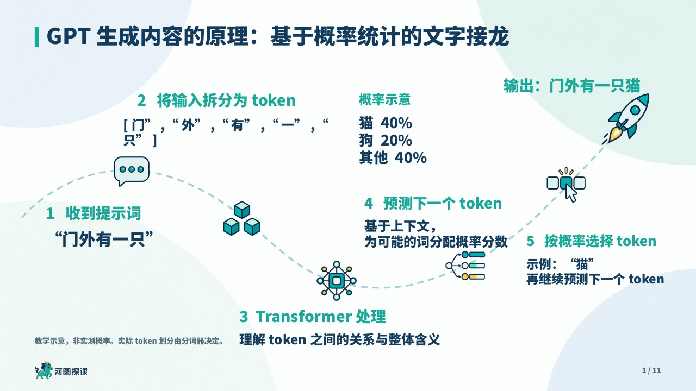

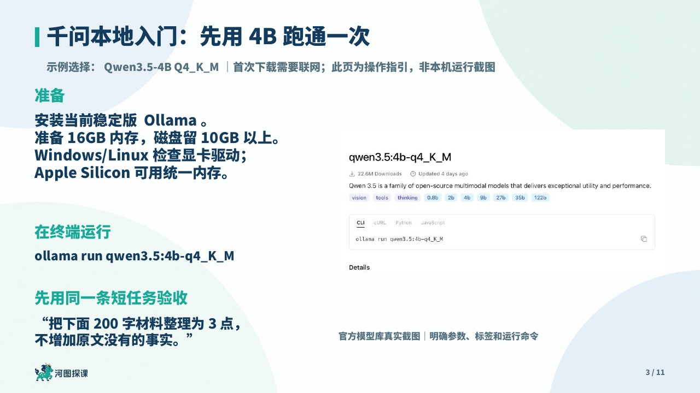

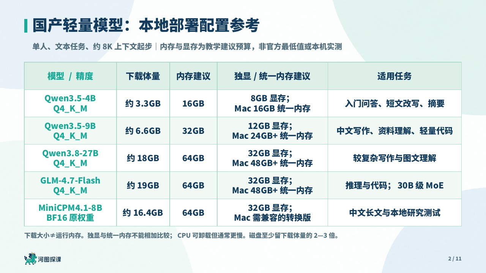

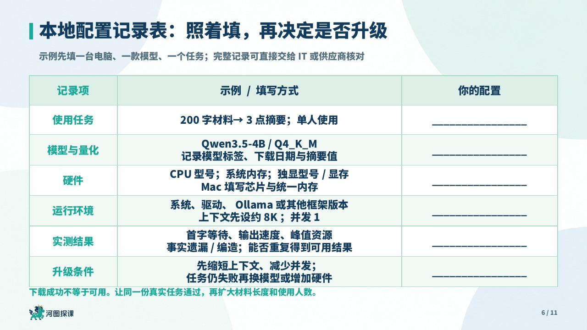

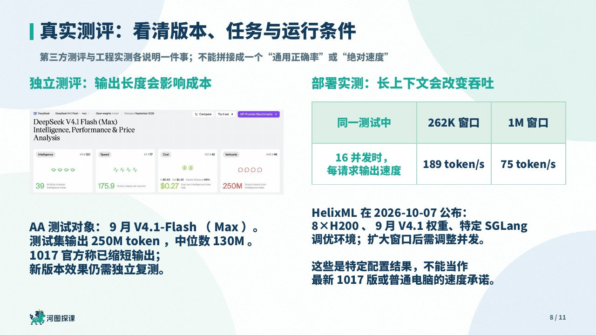

规则：[生动表达](skills/artifact-template-hetu-trainer-ppt/references/visual-storytelling.md) · [技术更新与证据](skills/artifact-template-hetu-trainer-ppt/references/technical-refresh.md) · [11张原生样页索引](skills/artifact-template-hetu-trainer-ppt/references/v3-approved-examples.md)

## 不止生成漂亮页面

| 你的任务 | 技能怎样处理 |
| --- | --- |
| 只有主题，开发一门课 | 从岗位任务和学习目标延展解释、案例、实操、练习、讲评与迁移 |
| 有简纲或资料 | 保留章意，补足知识前提、条件、误区、案例和验收；起承转合内化，不机械四页 |
| 更新旧技术课 | 保留教学目标与稳定概念，主动替换过时模型、界面与配置，记录依据；不增未授权章节 |
| 美化旧课，不能删内容 | 逐页逐对象保留原文、图片、表格和视频；用基线证明，不能摘要化 |
| 允许扩充 | 保留原页去向，新增辅助页单独记录；长原文用连续放大页 |
| 只改两页表格 | 只读目标页及必要依赖，原生大字居中、浅绿表格，范围外压缩成员原样 |

支持主题、培训需求、课纲、知识点、书籍、报告、文章、网页、讲稿、制度/SOP、访谈/会议、可读取音视频、软件截图、案例、数据、学员作品和持续对话。读取能力由当前环境决定，不宣称读取不可访问资料。

## 延续的品牌样式

以下预览都由新版原生参考PPT实际渲染。参考共27页，来自120页源课件；不是重新生成的效果图。文字、表格和逻辑图保持可编辑，背景和插画独立。

### 学习路线：鱼骨中轴

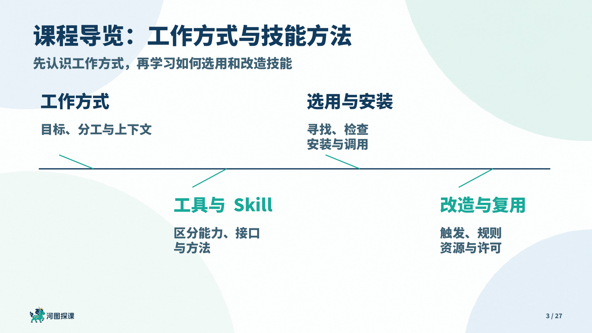

### 章节：图案解释主题


### 三幅功能插画与清楚的底部留白

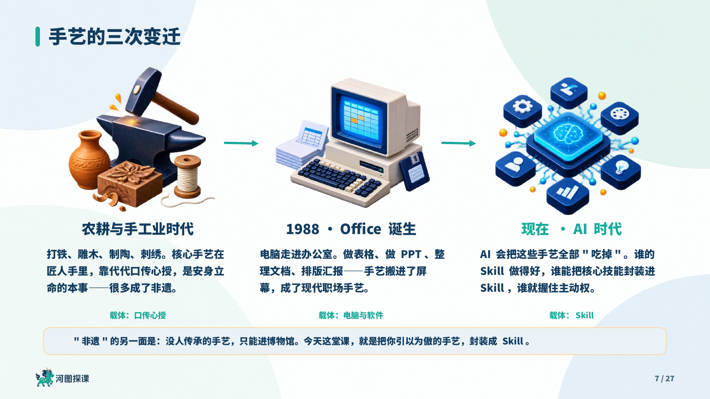

### 卡片随内容定高，修正框内空洞

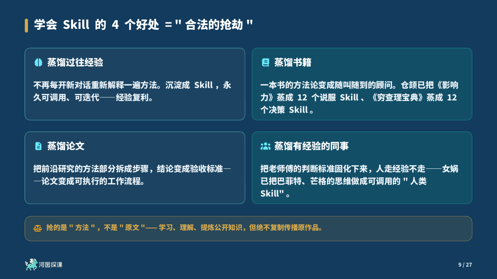

### 浅绿原生表格：大字、水平垂直居中

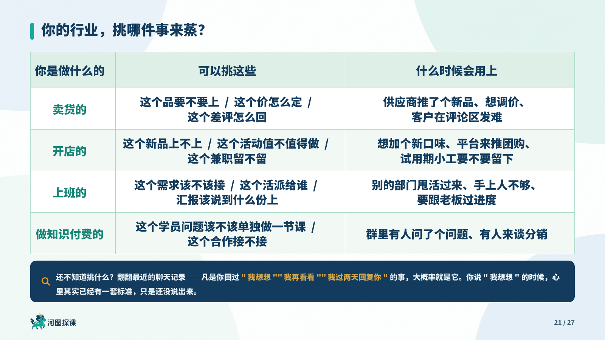

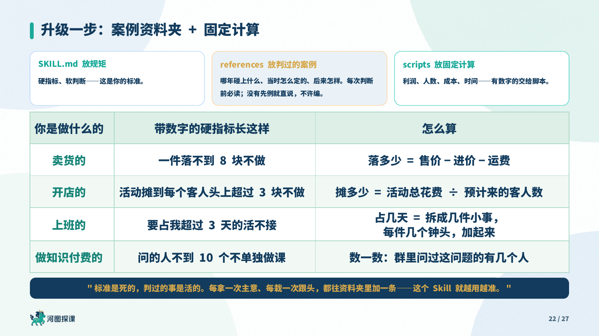

### 验证和讲评：看理由与标准

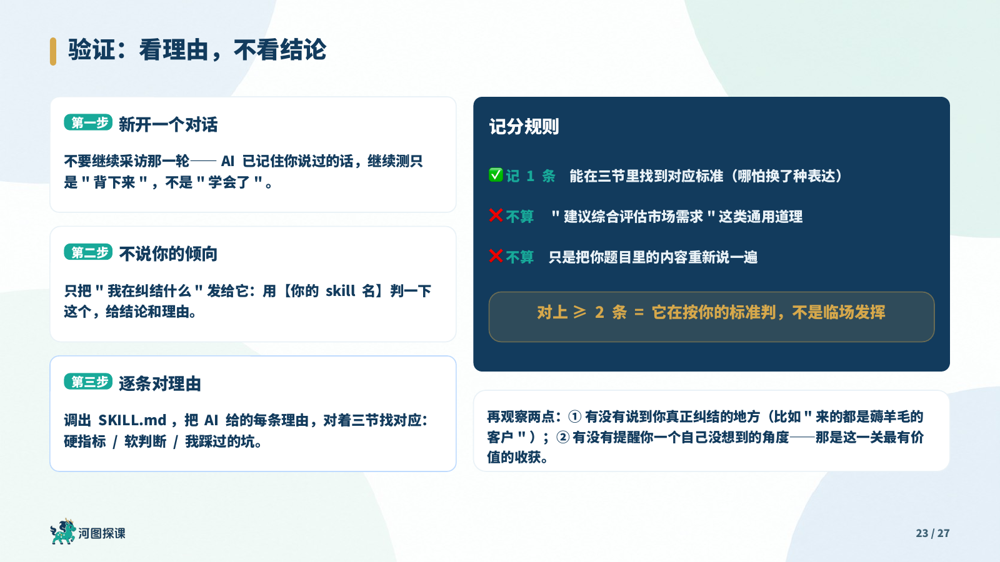

## 固定品牌与可变内容

- 16∶9；深蓝#123B5D、青绿#18A999，淡色边角大圆背景与近白阅读区。
- 可编辑文字统一**思源黑体Heavy并加粗**。新课正文建议18—26pt，按内容和投影可读性选择；长内容优先拆页。字体文件未随包分发。
- 图片、人物抠图与真实工具Logo**不加外框、阴影或强制圆角遮罩**，保留透明轮廓；知识流程框与表格线继续保留。
- **一个左下小Logo、一个右下小页码**，实际`n / N`；右上不放旧页码/章名/水印。
- 封面根据主题生成低干扰功能图；章节只保留大标题和一句概括，图案解释对象、关系或转化。
- 完整个人课程第2页锁定讲师介绍；其他培训师必须换成自己的真实身份，见[个人化配置](skills/artifact-template-hetu-trainer-ppt/references/personalization.md)。
- 新课、全套改稿与局部修改使用不同检查范围；用户只要PPT时，不额外交付一堆材料。

详细参数在[design-tokens.json](skills/artifact-template-hetu-trainer-ppt/design-tokens.json)，表达规则在[页型选择器](skills/artifact-template-hetu-trainer-ppt/references/expression-patterns.md)。这套课的标题、120页数、章数、产品年份与统计不是模板常量；新主题重新研究。

## 安装和升级

**目标是支持本地技能的ChatGPT桌面/Codex兼容环境。** 当前作者桌面显示名为ChatGPT，个人模板安装在`~/.codex/skills/artifact-template-hetu-trainer-ppt`。仓库发布不代表任意ChatGPT网页、手机或云工作区已自动安装。

下载完整zip，保留assets、references、scripts。已有同名技能时原位更新同一目录，别并列安装旧新两个版本；修改过个人品牌的用户先保留自己的配置，再合并升级。

可复制这段请求给支持技能安装的Agent：

```text
从 https://github.com/wuhetu619-crypto/hetu-ai-trainer-ppt
安装/升级“河图·AI讲师PPT”至v3.0.0。
仓库内目录：skills/artifact-template-hetu-trainer-ppt。
先识别同名现有版本，保留我的个人化配置，只保留一个活动安装。
保留完整素材，运行包检查，并验证技能发现与启用状态。
```

具体入口与云端区别见[安装与升级](docs/installation-and-upgrade.md)。

## 怎样调用

```text
使用河图·AI讲师PPT，制作《AI在税务系统中的应用》，15页，
面向税务干部中的AI初学者。联网研究，包含具体案例、实操、
学员练习和讲评。先给课纲和逐页规划。
```

```text
使用 $artifact-template-hetu-trainer-ppt，把附件旧PPT做保真精修。
每页、每字、图片和视频全部保留，页数不变，只优化形式，
不要整理课纲，不用额外生成学员材料。
```

```text
使用河图AI PPT，只把第101、102页的表格字体放大并居中，
加浅绿色边框；其余内容、对象、页面和页数都保持不变。
```

可以在@Presentations的模板图库中选择此个人模板（客户端需支持），或显式调用`$artifact-template-hetu-trainer-ppt`。技术ID不变：`artifact-template-hetu-trainer-ppt`。

## 检查与能力边界

```bash
python3 skills/artifact-template-hetu-trainer-ppt/scripts/check_package.py
python3 skills/artifact-template-hetu-trainer-ppt/scripts/run_regressions.py
```

包检查、原生对象/媒体比较、局部压缩成员证明与样式检查均只依赖Python标准库。结构通过不能代替视觉阅读、真实演示或原生软件播放。制作仍需要当前Agent具备PPT编辑、渲染、联网与按需生图能力；宝玉技能不是硬依赖。

公开包保留作者身份品牌示例与27张品牌主参考、11张补充原生样页，不包含完整120页成品、私人聊天、账户配置、密钥或字体文件。样例产品与数字仅为原课内容，不作为本项目新核实的事实；详见[样页与来源](docs/examples-and-sources.md)。
