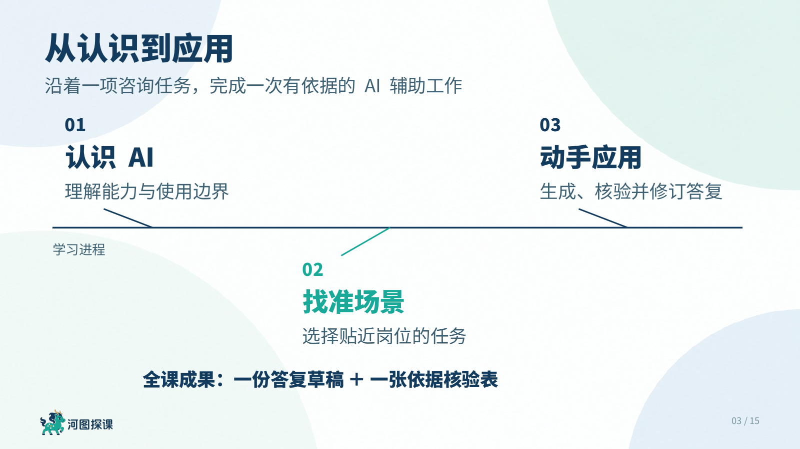

# 河图·AI讲师PPT

**培训师专用PPT技能，专门为培训师设计，尤其面向AI时代的培训师。**

**适用Agent：ChatGPT。** 需要支持技能、联网检索、图片生成、PPT编辑和渲染的环境；本次样例已在Codex桌面环境完成制作与检查。

把一个主题、一份课纲、一本书或一组资料，开发为有教学逻辑、有案例、有实操、有练习的培训课件。既规划“讲什么、学员怎么学”，也设计“每一页怎样表达”。


## 为培训师解决什么问题

- **只有主题，也能开发课程**：从学员、岗位任务与学习目标出发，延展知识、案例和课堂活动。
- **已有课纲，补齐教学链条**：每个实质知识单元按“起、承、转、合”组织，引入情境、解释方法、动手应用、反馈迁移；不机械拆成四页。
- **AI时代的课堂实操**：准备工具前提、真实界面截图、可复制指令、模拟案例、练习任务与核验标准。
- **按语义选表达**：流程用流程图，原理用机制图，故事配核实过的人物与场景，软件操作用真实截图，关键观点用大字金句。
- **讲课能看清，讲完能练习**：大字号、规整对齐、充分留白；复杂内容主动拆页，配套学员练习和讲师参考答案。
- **后续修改有连续性**：多轮反馈局部修改，保持已经确认的版式、身份与品牌素材。

不局限于AI课程，也适用于管理、岗位技能、业务制度、工具使用等培训；“AI时代”指借助AI开发、表达与实操的教学方式。

## 样式预览

以下均来自《AI在税务系统中的应用》15页测试课件的实际渲染页面。正文、流程和表格保留为PPT中的原生可编辑对象；背景与插画独立。案例有公开出处，练习问题及示范答复标注为课堂模拟。

### 鱼骨大纲：让学员看懂学习路线



### 章节页：用有功能的图形解释主题


### 知识页：三幅插画对应三个知识点


### 演示页：真实资料与讲师示范相互对应


### 练习页：案例、时间、提交物和检查要求


## 视觉与课件规范

| 项目 | 默认设计 |
| --- | --- |
| 画幅 | 16∶9 |
| 品牌氛围 | 深蓝、青绿，少量薄荷色和金色 |
| 标题与正文 | 思源黑体Heavy / Regular；内容标题36—40pt，普通正文建议22—26pt |
| 封面 | 根据课程主题生成低干扰的蓝绿背景，自动提炼副标题和可选主题句 |
| 讲师介绍 | 完整课程第2页，固定已确认介绍布局，使用真实照片与资历 |
| 大纲 | 鱼骨中轴，上下交替章节标题与概括 |
| 章节 | 大标题＋一句概括＋有语义关系的渐变背景 |
| 内容 | 边角淡色大圆与中央清晰阅读区，文字图形对齐，页脚留足空间 |
| 可编辑性 | 文字、逻辑图、表格与数据图原生可编辑；插画背景独立 |
| 交付 | PPTX、PDF、学员练习材料、讲师备注/答案、来源和版本记录 |

## 支持什么输入

主题、培训需求、简单或详细课纲、知识点、书籍、文章、网页、论文、旧课件、制度/SOP、访谈与会议记录、可读取的录音/视频、操作截图、案例、数据、学员作品与问题，以及混合材料和持续对话。

能读取哪些文件和链接取决于当前环境。内容不足时先做合理假设和研究；无法查证的部分明确标注，不补造事实或操作证据。

## 安装

### ChatGPT

下载 [最新版完整技能包](https://github.com/wuhetu619-crypto/hetu-ai-trainer-ppt/releases/latest)，在支持本地技能的ChatGPT桌面环境中，请技能安装器导入完整文件夹并检查资源。请保留 `assets`、`references` 和 `scripts`，不要只复制 `SKILL.md`。

启用后，可在ChatGPT中通过 `@` 选择技能，或直接说明“使用河图·AI讲师PPT”。技能可用范围和入口以当前客户端为准；本仓库发布的是技能源文件和安装包，未宣称已上架ChatGPT插件目录。参见 [OpenAI官方技能说明](https://learn.chatgpt.com/docs/build-skills)。

### Codex：复制这段安装请求

```text
使用 skill-installer，从这个GitHub仓库安装“河图·AI讲师PPT”：
https://github.com/wuhetu619-crypto/hetu-ai-trainer-ppt
技能目录：skills/artifact-template-hetu-trainer-ppt
保留完整素材，运行资源检查，并告诉我调用方式。
如果已经安装同名技能，先核对现有版本，避免重复安装。
```

安装了支持 `gh skill` 的GitHub CLI时，也可执行：

```bash
gh skill install wuhetu619-crypto/hetu-ai-trainer-ppt skills/artifact-template-hetu-trainer-ppt --agent codex --scope user
```

## 如何调用

**直接做一套培训：**

```text
使用河图·AI讲师PPT，制作《AI在税务系统中的应用》，15页，
面向税务干部中的AI初学者。自行联网研究，加入公开案例、
模拟实操、学员练习和讲评，直接完成第一版。
```

**先规划再制作：**

```text
使用河图·AI讲师PPT，把附件课纲开发为90分钟培训。
先给课纲与逐页规划，每章补充必要知识、案例、练习和讲评。
我的讲师介绍、真实照片与Logo以附件为准。
```

**把书变成课程：**

```text
使用河图·AI讲师PPT，把这本书改编成管理者沟通培训。
保留重要观点和来源定位，加入岗位情境、判断题与练习。
```

**持续改稿：**

```text
第三章太抽象，加一幅机制图和一道判断题；其他已确认页面保持。
```

技术ID：`artifact-template-hetu-trainer-ppt`。Codex中可用 `$artifact-template-hetu-trainer-ppt` 显式调用。

## 换成你的讲师品牌

包内保留吴河图个人介绍和河图探课Logo，作为作者品牌样例。其他培训师使用时，应替换为自己的真实照片、姓名、资历与Logo；不得把样例作者身份作为自己的信息。详见 [个人化配置](skills/artifact-template-hetu-trainer-ppt/references/personalization.md)。

默认思源黑体，字体文件未随包分发。制作需要可用的联网、生图、PPT编辑和渲染工具；技能本身提供方法、规则、检查脚本和素材，不是脱离Agent独立运行的应用。宝玉技能不是硬依赖。

## 包结构与检查

```text
skills/artifact-template-hetu-trainer-ppt/
├── SKILL.md                技能入口
├── agents/openai.yaml      中文显示名称与调用提示
├── references/             教学、版式、制作与个人化规范
├── assets/                 原生样页、背景、品牌、预览与资源清单
├── examples/               课程开发示例
└── scripts/                资源与PPT结构检查
```

```bash
python3 skills/artifact-template-hetu-trainer-ppt/scripts/check_package.py
```

结构检查不能替代逐页视觉和教学审校。公开包不包含封装前的聊天/讨论档案、本机环境配置或API密钥。

样例公开资料出处见 [截图来源与案例说明](docs/examples-and-sources.md)。
